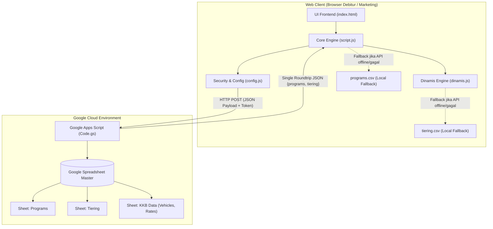
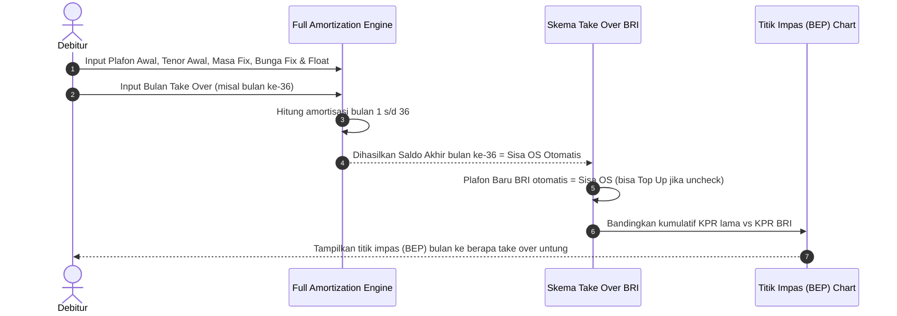
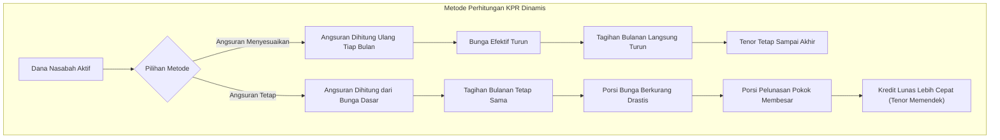
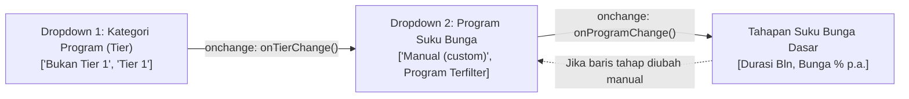

# 📘 DOKUMEN HANDOFF SISTEM & LOGIKA KALKULATOR KPR BRI
> **Versi Dokumentasi:** 2.0 (KPR Engine & Unified API)  
> **Target Aplikasi:** Kalkulator KPR & Analisis Take Over Debitur (BRI)  
> **Terakhir Diperbarui:** 11 November 2026  
> **Penyusun:** Tim Pengembang AI / Advanced Agentic Coding

---

## 📑 DAFTAR ISI
1. [Arsitektur Sistem & Alur Integrasi](#1-arsitektur-sistem--alur-integrasi)
2. [Integrasi Google Spreadsheet & Unified API (`Code.gs`)](#2-integrasi-google-spreadsheet--unified-api-codegs)
3. [Struktur Data Baru & Manajemen State](#3-struktur-data-baru--manajemen-state)
4. [Logika Matematis & 4 Modul Simulasi KPR](#4-logika-matematis--4-modul-simulasi-kpr)
   - [4.1 Modul KPR Baru (`#kpr-baru`)](#41-modul-kpr-baru-kpr-baru)
   - [4.2 Modul Take Over Float (`#to-float`)](#42-modul-take-over-float-to-float)
   - [4.3 Modul Take Over Fix (`#to-fix`)](#43-modul-take-over-fix-to-fix)
   - [4.4 Modul KPR Dinamis (`#kpr-dinamis`)](#44-modul-kpr-dinamis-kpr-dinamis)
5. [Logika Dropdown Bertingkat & UI/UX](#5-logika-dropdown-bertingkat--uiux)
6. [Mekanisme Keamanan, Obfuskasi & Fallback Offline](#6-mekanisme-keamanan-obfuskasi--fallback-offline)
7. [Panduan Pemeliharaan & Operasional Tim](#7-panduan-pemeliharaan--operasional-tim)

---

## 1. Arsitektur Sistem & Alur Integrasi

Aplikasi Kalkulator KPR BRI dirancang sebagai **Single Page Application (SPA)** yang responsif, modern, dan ringan tanpa dependensi framework berat (*Zero-Build Stack*), dibangun dengan:
* **UI & Styling:** HTML5 murni, TailwindCSS (via CDN), Google Fonts (Inter).
* **Data Visualization:** Chart.js 4.4 + Chart.js Annotation Plugin (garis titik impas / BEP).
* **Core Logic:** Vanilla JavaScript ES6+ modular (`script.js`, `dinamis.js`, `config.js`).
* **Cloud Database Backend:** Google Apps Script Web App yang terhubung langsung ke **Google Spreadsheet**.



---

## 2. Integrasi Google Spreadsheet & Unified API (`Code.gs`)

### 2.1 Konsep Unified API (Satu Endpoint untuk KKB & KPR)
Sebelumnya, endpoint API hanya melayani kalkulator KKB atau membaca sheet tunggal. Arsitektur terbaru menyatukan seluruh database ke dalam **satu Spreadsheet dan satu endpoint Google Apps Script Web App** yang dapat melayani KKB maupun KPR sekaligus.

### 2.2 Kontrak Permintaan & Keamanan Endpoint
* **HTTP GET:** Ditolak total dengan respon `405 Method Not Allowed`. Mencegah pengguna iseng membuka URL di browser secara langsung.
* **HTTP POST:** Menerima body payload berformat JSON dengan format otorisasi:
  ```json
  {
    "token": "<TOKEN — disimpan di Script Properties, jangan ditulis di repo>",
    "type": "kpr"
  }
  ```

### 2.3 Respon Data Tunggal (*Single Round-trip*)
Dalam 1 kali request HTTP POST, endpoint Apps Script langsung mengembalikan data program KPR sekaligus data tabel tiering KPR Dinamis:
```json
{
  "status": "success",
  "service": "kpr",
  "count": 20,
  "tiering_count": 20,
  "updated_at": "2026-11-10T08:00:00.000Z",
  "programs": [
    {
      "tier": "Bukan Tier 1",
      "key": "fixed_3_7_10",
      "name": "Fixed 3 Th 7% Tenor 10 Th",
      "min_months": 120,
      "segments": "36:7.00|84:10.50"
    }
  ],
  "tiering": [
    {
      "min_ratio": 0.1,
      "label": "10 - <20%",
      "tabungan": -0.4,
      "giro": -0.4,
      "deposito": -0.35
    }
  ]
}
```

### 2.4 Logika Parser Sheet Fleksibel di `Code.gs`
1. **Deteksi Sheet Otomatis:**
   * Script mencari sheet program: `Programs`, `programs`, `PROGRAMS`, atau nama sheet yang mengandung kata `program`.
   * Script mencari sheet tiering: `Tiering`, `tiering`, `TIERING`, `Tier`, atau nama sheet yang mengandung kata `tier`.
2. **Normalisasi Angka:**
   * **Batas Rasio:** Jika diinput sebagai persen (misal `10%`) atau angka puluhan (misal `10`), otomatis dikonversi ke desimal `0.10`.
   * **Pengurang Bunga:**
     * Jika tersimpan dalam desimal pecahan Excel (misal `-0.004`), sistem mengalikan $100$ menjadi `-0.40%`.
     * Jika diinput positif (`0.40`), sistem membalik tandanya menjadi negatif (`-0.40%`) karena fungsinya adalah pengurang suku bunga.

---

## 3. Struktur Data Baru & Manajemen State

### 3.1 Struktur Objek Program Suku Bunga (`PROGRAMS`)
Data mentah dari API atau CSV dipetakan ke dalam struktur dictionary hierarkis bertingkat berdasarkan Tier:

```javascript
// Contoh Struktur Objek Global: window.PROGRAMS
{
  "Bukan Tier 1": {
    "fixed_3_7_10": {
      name: "Fixed 3 Th 7% Tenor 10 Th",
      min_months: 120,
      segments: [
        [36, 7.00],   // [Durasi bulan, Suku bunga % p.a.]
        [84, 10.50]
      ]
    },
    "fixed_5_8_15": {
      name: "Fixed 5 Th 8% Tenor 15 Th",
      min_months: 180,
      segments: [
        [60, 8.00],
        [120, 11.00]
      ]
    }
  },
  "Tier 1": {
    "tier1_fixed_3_65": {
      name: "Tier 1 - Fixed 3 Th 6.5% Tenor 10 Th",
      min_months: 120,
      segments: [
        [36, 6.50],
        [84, 10.00]
      ]
    }
  }
}
```

### 3.2 Struktur Data Tabel Tiering (`DIN_TIERS`)
Menyimpan matriks pengurang suku bunga Usulan CSL Group 80% LS:
```javascript
// [Batas Bawah Rasio, Label Rentang, Tabungan (% p.a.), Giro (% p.a.), Deposito (% p.a.)]
let DIN_TIERS = [
  [0.10, "10 - <20%",  -0.40, -0.40, -0.35],
  [0.20, "20 - <30%",  -0.80, -0.85, -0.70],
  [0.30, "30 - <40%",  -1.00, -1.30, -1.00],
  [0.40, "40 - <50%",  -1.50, -1.70, -1.30],
  [0.50, "50 - <60%",  -2.00, -2.15, -1.70],
  [0.60, "60 - <70%",  -2.30, -2.60, -2.00],
  [0.70, "70 - <80%",  -2.75, -3.00, -2.40],
  [0.80, "80 - <90%",  -3.25, -3.40, -2.75],
  [0.90, "90 - <100%", -3.50, -3.90, -3.00],
  [1.00, "100 - <110%",-4.00, -4.30, -3.50],
  [1.10, "110 - <120%",-4.50, -4.80, -3.75],
  [1.20, "120 - <130%",-4.75, -5.20, -4.00],
  [1.30, "130 - <135%",-5.25, -5.60, -4.50],
  [1.35, "135 - <140%",-5.50, -5.90, -4.70],
  [1.40, "140 - <150%",-5.75, -6.10, -5.00],
  [1.50, "150 - <160%",-6.00, -6.50, -5.20],
  [1.60, "160 - <170%",-6.50, -7.00, -5.50],
  [1.70, "170 - <180%",-7.00, -7.40, -6.00],
  [1.80, "180 - <190%",-7.25, -7.85, -6.25],
  [1.90, "≥ 190%",      -7.50, -8.00, -6.50]
];
```

### 3.3 State Management & Sinkronisasi
* **State Utama KPR (`state` di `script.js`):** Menyimpan tahapan bunga aktif, mode aktif (`kpr-baru`, `to-float`, `to-fix`, `kpr-dinamis`), status biaya take over, input eksisting, dan input RPC.
* **State KPR Dinamis (`din` di `dinamis.js`):** Menyimpan plafon kredit, metode kalkulasi (`adjust` atau `tetap`), tahapan bunga dasar, variasi dana nasabah (jumlah, jenis, bulan mulai, durasi), serta status visibilitas tabel amortisasi.
* **Persistensi Lokal:** Tersimpan di `localStorage` per browser client (`kpr-calc-v1` dan `kpr-dinamis-v1`) sehingga simulasi terakhir nasabah tidak hilang saat halaman di-refresh.

---

## 4. Logika Matematis & 4 Modul Simulasi KPR

### 4.1 Modul KPR Baru (`#kpr-baru`)

#### A. Formula Angsuran Anuitas Bertahap
Angsuran bulanan ($PMT$) untuk setiap tahap dihitung dengan rumus anuitas standar perbankan:
$$PMT = P \times \frac{r \times (1 + r)^n}{(1 + r)^n - 1}$$

* $P$ = Sisa pokok pinjaman pada awal tahap.
* $r$ = Suku bunga bulanan ($\frac{\text{Bunga per tahun}}{12 \times 100}$).
* $n$ = Sisa tenor pinjaman dari awal tahap tersebut hingga akhir kredit.

Setiap bulan, bunga berjalan dihitung:
$$I_m = B_{m-1} \times r$$
Porsi pokok yang terbayar:
$$P_m = PMT - I_m$$
Saldo akhir bulan:
$$B_m = B_{m-1} - P_m$$

Pada bulan terakhir kredit ($m = N$), saldo akhir otomatis dipaksa bulat menjadi **Rp 0** (menghilangkan sisa pecahan perak yang membingungkan debitur).

#### B. Cek Kemampuan Bayar (RPC / Repayment Capacity)
Mengukur kelayakan finansial debitur:
1. **Rasio Maksimal Angsuran terhadap Pendapatan:**
   * Pendapatan $< \text{Rp } 15 \text{ Juta} \rightarrow 50\%$
   * Pendapatan $\text{Rp } 15\text{–}25 \text{ Juta} \rightarrow 55\%$
   * Pendapatan $> \text{Rp } 25 \text{ Juta} \rightarrow 60\%$
2. **Kapasitas Angsuran Tersedia:**
   $$\text{Maksimal Angsuran} = (\text{Pendapatan} \times \text{Rasio}) - \text{Angsuran Berjalan Lain}$$
3. **Fitur Input Kustom:** Debitur dapat langsung mengisi angka maksimal angsuran yang dikehendaki secara manual.
4. **Validasi:** Sistem membandingkan angsuran KPR tahap pertama dan puncak angsuran dengan batas maksimal angsuran debitur, menampilkan status kelayakan hijau (Mampu Bayar) atau kuning (Belum Mampu Bayar).

#### C. Visualisasi Data Kumulatif
Grafik garis Chart.js yang memvisualisasikan kumulatif akumulasi pembayaran:
* Garis Biru: Kumulatif Total (Pokok + Bunga)
* Garis Hijau: Kumulatif Pokok
* Garis Oranye: Kumulatif Bunga
* Dilengkapi tombol toggle centang di samping kanan judul grafik untuk menyalakan/mematikan masing-masing garis dataset.

---

### 4.2 Modul Take Over Float (`#to-float`)
Ditujukan untuk debitur yang KPR lamanya di bank lain sudah memasuki masa bunga mengambang (*floating*).

1. **Input Sisa OS & Bunga Float Eksisting:** Debitur memasukkan sisa pokok hutang di bank lama dan suku bunga float yang sedang berjalan.
2. **Angsuran Eksisting:** Sistem menghitung estimasi angsuran di bank lama dan menyediakan opsi konfirmasi:
   * **Sesuai:** Menggunakan hasil hitungan sistem.
   * **Tidak Sesuai:** Menampilkan field input manual agar debitur dapat memasukkan angka riil angsuran eksistingnya.
3. **Biaya Tambahan Take Over:** Ditempatkan di bagian bawah kartu Skema Take Over BRI (pilihan persen atau nominal). Nilai ini dihitung pada bulan ke-0.
4. **Ringkasan Perbandingan ("Kondisi Angsuran"):**
   * Menampilkan perbandingan angsuran bulan ke-1 di BRI vs angsuran eksisting.
   * Total pembayaran di BRI sudah memperhitungkan biaya take over.
   * Memberikan label status efisiensi: **Hemat Rp ...** atau **Lebih Rp ...**.

---

### 4.3 Modul Take Over Fix (`#to-fix`)
Inovasi penting pada modul ini adalah menyelesaikan kendala psikologis debitur: **debitur tidak tahu persis sisa pokok hutangnya di tengah masa bunga fix karena angkanya keriting**.



1. **Simulasi Amortisasi Bank Sebelumnya:**
   * Menghitung angsuran masa bunga fix dari plafon awal dan tenor total awal.
   * Melakukan amortisasi dari bulan ke-1 sampai ke bulan take over yang diinputkan debitur.
   * Saldo akhir pada bulan tersebut secara otomatis menjadi **Sisa OS Take Over**.
2. **Sinkronisasi Plafon Otomatis:**
   * Terdapat toggle *"Plafon Take Over = Sisa OS"*.
   * Saat aktif (default), plafon yang diajukan ke BRI otomatis sama dengan Sisa OS tersebut.
   * Jika dinonaktifkan, debitur dapat memasukkan plafon baru yang lebih tinggi (fasilitas Top Up pinjaman).
3. **Analisis Titik Impas (BEP):**
   * Mengakumulasikan biaya total yang dibayarkan di bank lama (bulan take over $\times$ angsuran lama) ditambah biaya take over.
   * Memetakan garis kumulatif KPR lama vs KPR BRI pada bulan berjalan yang sama.
   * Menghitung secara eksak di bulan ke berapa biaya take over tertutupi oleh selisih penghematan bunga BRI (Titik Impas / BEP).

---

### 4.4 Modul KPR Dinamis (`#kpr-dinamis`)
Mengakomodasi produk khusus BRI di mana debitur yang menempatkan dana (Tabungan, Giro, Deposito) berhak mendapatkan **pengurang suku bunga pinjaman (tiering CSL Usulan Group 80% LS)**.

#### A. Mekanisme Tiering & Pengurang Bunga
Untuk setiap variasi penempatan dana:
$$\text{Rasio Dana} = \frac{\text{Jumlah Dana yang Ditempatkan}}{\text{Plafon Pinjaman}}$$

Sistem mencari tier pada tabel `DIN_TIERS`:
* Jika rasio $< 10\%$: Tidak ada pengurang ($0\%$).
* Jika rasio $\ge 190\%$: Mendapat tier tertinggi (tier 20).
* Pengurang suku bunga ($\Delta r$) diambil sesuai kolom instrumen dana (Tabungan, Giro, atau Deposito).

Bunga efektif pada bulan ke-$m$:
$$r_{\text{eff}}(m) = \max\left(0,\, r_{\text{dasar}}(m) + \sum \Delta r_v(m)\right)$$

#### B. Dua Metode Perhitungan Angsuran



1. **Metode 1: Angsuran Menyesuaikan (*Cashflow Saver*)**
   * Angsuran dihitung ulang setiap bulan secara anuitas dari sisa pokok berjalan, sisa tenor yang tersisa, dan bunga efektif bulan tersebut.
   * Tagihan bulanan debitur **langsung turun lebih murah** saat dana aktif.
   * Jangka waktu (tenor) kredit **tetap sama** sesuai kontrak awal.

2. **Metode 2: Angsuran Tetap (*Fast Payoff / Bebas Hutang Lebih Cepat*)**
   * Angsuran bulanan dihitung berdasarkan suku bunga dasar (tanpa pengurang) dan bernilai tetap selama tahap tersebut berjalan.
   * Porsi bunga yang dibebankan mengecil karena adanya dana pengurang.
   * Selisih angsuran dialokasikan untuk **mempercepat pemotongan saldo pokok pinjaman**.
   * Pokok pinjaman tergerus sangat cepat sehingga kredit **sudah lunas sebelum tenor berakhir**.

---

## 5. Logika Dropdown Bertingkat & UI/UX

Untuk menjaga konsistensi antarmuka pengguna pada seluruh tab KPR (khususnya KPR Baru dan KPR Dinamis), diterapkan sistem **Dropdown Bertingkat 2 Level**:



1. **Dropdown 1 (Kategori Tier):**
   * Mengelompokkan program menjadi `Bukan Tier 1` dan `Tier 1` (serta tier kustom lain yang ditambahkan di Google Spreadsheet).
2. **Dropdown 2 (Program Suku Bunga):**
   * Secara dinamis hanya menampilkan program yang termasuk dalam kategori Tier yang sedang aktif.
   * Saat program dipilih:
     * Seluruh baris tahapan durasi dan suku bunga otomatis terisi.
     * Tenor pinjaman otomatis terkunci sesuai total durasi program.
     * Memberikan teks keterangan ringkasan skema di bawah dropdown (misal: `Skema: 36 bln (7%) + 84 bln (10.5%)`).
3. **Deteksi Perubahan Manual:**
   * Jika pengguna mengubah angka durasi atau suku bunga pada salah satu baris tahap, pilihan pada dropdown program otomatis beralih ke `Manual (custom)` dan petunjuk skema dikosongkan.

---

## 6. Mekanisme Keamanan, Obfuskasi & Fallback Offline

Aplikasi ini aman dijalankan di lingkungan publik/debitur tanpa mengekspos URL backend Google Apps Script dan Token API secara terang-terangan di kode sumber.

### 6.1 Obfuskasi Kunci API (`config.js`)
* URL Deployment Google Apps Script dan Token Akses dienkripsi menggunakan teknik **XOR Obfuscation** + **Base64 Encoding** melalui script `obfuscate.py` atau `obfuscate.js`.
* Di runtime browser, file `config.js` mendekripsi string tersebut hanya di memori JavaScript saat hendak melakukan permintaan HTTP POST.

### 6.2 Sistem Fallback Bertingkat (*Graceful Degradation*)
Aplikasi dirancang agar tetap 100% berfungsi meskipun jaringan internet debitur terputus atau API Google sedang mengalami gangguan:

```
[Mulai Load Programs]
       │
       ▼
Apakah URL Endpoint & Token Valid?
  ├── YA  ──> Lakukan HTTP POST ke Google Apps Script
  │             ├── SUKSES ──> Gunakan data live Programs & Tiering (Database Cloud)
  │             └── GAGAL  ──> Beralih ke file lokal
  └── TIDAK ─────────────────> Beralih ke file lokal
                                      │
                                      ▼
                      Baca programs.csv & tiering.csv lokal
```

---

## 7. Panduan Pemeliharaan & Operasional Tim

### 7.1 Cara Menambah Program KPR Baru di Google Spreadsheet
1. Buka Google Spreadsheet database KPR.
2. Masuk ke sheet **`Programs`**.
3. Tambahkan baris baru dengan format kolom:
   * **`tier`**: `Bukan Tier 1` atau `Tier 1`.
   * **`key`**: Identifier unik huruf kecil tanpa spasi (misal: `fixed_1_35_10`).
   * **`name`**: Nama program yang tampil di dropdown (misal: `Fixed 1 Th 3.5% Tenor 10 Th`).
   * **`min_months`**: Minimal total tenor dalam bulan (misal: `120`).
   * **`segments`**: Rangkaian `durasi:bunga` dipisahkan tanda `|` (misal: `12:3.50|108:11.00`).
4. Data akan langsung ter-update di web aplikasi saat halaman di-refresh.

### 7.2 Cara Mengubah Tabel Tiering KPR Dinamis di Google Spreadsheet
1. Masuk ke sheet **`Tiering`**.
2. Pastikan kolom memuat: `Batas Bawah` | `Tiering` | `Tabungan` | `Giro` | `Deposito`.
3. Masukkan batas bawah rasio (misal `0.10` untuk 10%) dan nilai pengurang suku bunga (misal `-0.40%` atau `-0.004`).
4. Web app otomatis membaca perubahan tersebut dan menyesuaikan kalkulasi pengurang suku bunga.

### 7.3 Cara Memperbarui Kode Backend Google Apps Script
Jika file [`google-apps-script/Code.gs`](google-apps-script/Code.gs) mengalami perubahan logika:
1. Buka spreadsheet Google > Menu **Extensions** (Ekstensi) > **Apps Script**.
2. Salin seluruh kode terbaru dari `Code.gs` lokal dan gantikan isi di editor Apps Script.
3. Klik tombol **Save** (💾).
4. Klik **Deploy** (Terapkan) di pojok kanan atas > **Manage deployments** (Kelola penerapan).
5. Klik ikon **Edit** (✏️) pada deployment aktif.
6. Pada dropdown **Version**, pilih **New version** (Versi baru).
7. Klik **Deploy** (Terapkan).

---

### 8. Referensi File Penting dalam Repositori
* [`index.html`](index.html) — Antarmuka pengguna (UI), modal dialog info, struktur 4 tab simulasi KPR.
* [`script.js`](script.js) — Logika utama kalkulator (KPR Baru, Take Over Float, Take Over Fix, data loader, validasi RPC, Chart.js render).
* [`dinamis.js`](dinamis.js) — Mesin simulasi khusus KPR Dinamis (metode anuitas menyesuaikan, amortisasi dipercepat tetap, pemetaan tiering CSL).
* [`google-apps-script/Code.gs`](google-apps-script/Code.gs) — Backend API serverless Google Apps Script penyedia data `programs` dan `tiering`.
* [`config.js`](config.js) — Konfigurasi kredensial dan URL API terenkripsi.
* [`programs.csv`](programs.csv) — Cadangan database program suku bunga lokal offline.
* [`tiering.csv`](tiering.csv) — Cadangan database tabel tiering CSL pengurang bunga lokal offline.
* [`Tambahan/`](Tambahan/) — Berkas Excel acuan resmi perhitungan formula KPR Dinamis (`Simulasi_Angsuran_KPR DInamis.xlsx` dan `Kalkulator_Angsuran_Dinamis V2.xlsx`).
